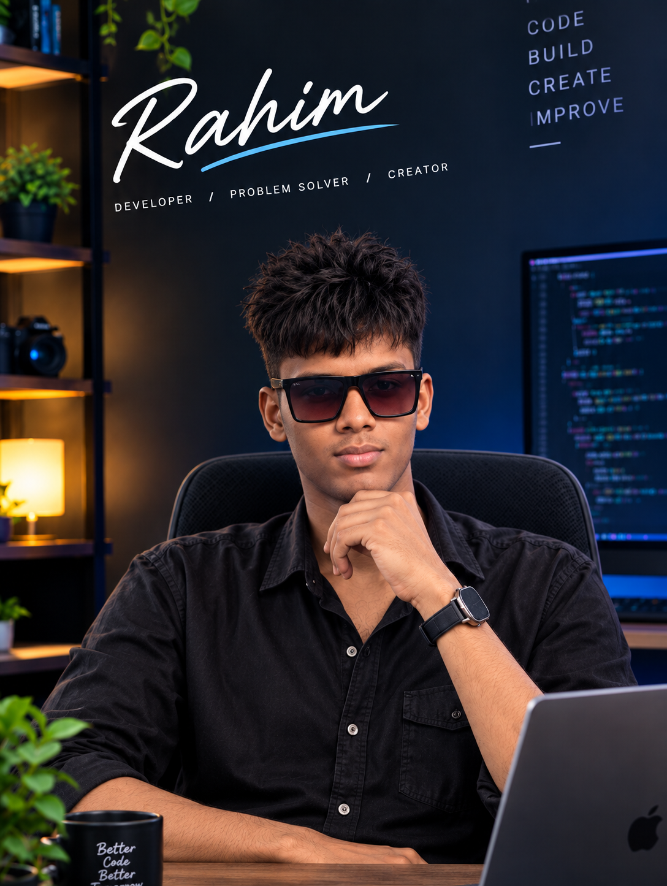

# 🚀 Sk Rahim Alli - 3D Animated Portfolio

An ultra-modern, high-performance 3D animated portfolio website built for **Sk Rahim Alli** (Full Stack Developer & AI Engineer).



---

## ✨ Features & Highlights

### 🌌 1. Interactive 3D WebGL Hero Section (`three-hero.js`)
- **Cybernetic 3D Core**: Multi-layered rotating geometry featuring an outer wireframe Icosahedron, inner metallic Torus Knot, and glowing plasma sphere.
- **Particle Constellation**: 1,500+ dynamic 3D particles with additive glow blending and smooth depth distribution.
- **Interactive Parallax & Shockwave**: Mouse-responsive 3D camera tracking and click-triggered radial shockwave pulse.
- **Holographic 3D Avatar Card**: Displays Rahim's authentic photo with a holographic scanline sweep, dynamic 3D tilt tracking, and orbiting 3D status badges (`🟢 Available to work`, `⚡ Full-Stack Developer`, `🤖 AI & ML Engineer`).

### 🖱️ 2. Custom Cyber Cursor & Particle Sparks (`cursor.js`)
- **Zero-Latency Dual Cursor**: High-precision center dot + smooth trailing aura ring with lerp interpolation.
- **Dynamic Particle Trail**: Emits fading neon cyan and purple sparks during cursor movement and click shockwaves.
- **Magnetic Snap & Custom Contexts**: Expands and snaps with magnetic physics over buttons, links, and cards (`VIEW`, `HELLO`, `CV`, `CODE`, `CHAT`, `TILT`).
- Native touch-device detection to preserve smooth mobile experience.

### 📜 3. Scroll Animations & 3D Motion System (`main.js` & `style.css`)
- **Smooth Momentum Scrolling**: Integrated with **Lenis** for silky 60/120fps frictionless scrolling.
- **Laser Scroll Progress Bar**: Gradient neon beam across the header with a live percentage indicator.
- **3D Card Tilt with Specular Glare**: Real-time perspective calculation (`perspective(1000px) rotateX(...) rotateY(...) scale3d(...)`) with dynamic radial light glare tracking pointer movement.
- **GSAP ScrollTrigger**: Staggered 3D entrance and blur-to-sharp reveal animations for sections and cards.
- **Illuminated Circuit Timeline**: Glowing neon nodes and circuit laser line connecting internships, awards, hackathon wins, and education milestones.

### 🎧 4. Cyber Audio Synthesizer (Web Audio API)
- Real-time synthesized futuristic sound effects for hovering, clicking, and toggling.
- Includes a dedicated **SFX Toggle Button** with an animated audio equalizer in the navbar for complete user control.

### 📋 5. Complete Data Coverage from Rahim's Site
- **Hero & Identity**: Roles typewriter animation, summary, location, live Asia/Kolkata (IST) local clock.
- **Stats Counter**: Animated count-up for Projects Built (5+), Git Commits (500+), CGPA (8.0), Hackathons Won (3+).
- **Skills Matrix**: 18 technical skills with category filtering (Frontend, Backend, Programming, AI & Data Science, Tools & DevOps) and glowing proficiency meters.
- **Featured Projects**: Filterable project cards with architectural highlights, tech tags, quick view modal, and GitHub links.
- **Timeline / Journey**: Milestones from 2026 to 2030 (AI Internships, University 1st Place, Hackathon Winner).
- **Academics & Verified Certifications**: B.Tech CSE (Data Science) and verified badges.
- **Interactive Resume**: Clean, high-tech resume viewer with instant **Print or Save as PDF** support.
- **Contact & Fast Actions**: One-click clipboard copy for Email and Phone with celebratory confetti, WhatsApp chat link, LinkedIn connect, and interactive inquiry form.

---

## 🛠️ Tech Stack

- **Graphics**: [Three.js](https://threejs.org/) (WebGL 3D Scene)
- **Animations**: [GSAP](https://greensock.com/gsap/) & [ScrollTrigger](https://greensock.com/scrolltrigger/)
- **Smooth Scrolling**: [Lenis](https://github.com/darkroomengineering/lenis)
- **Styling**: Modern CSS3 (Cyberpunk Glassmorphism, 3D Transforms, Custom Properties)
- **Effects**: Web Audio API Synthesizer, Canvas Confetti

---

## 🚀 How to Run Locally

You can open `index.html` directly in any modern browser, or launch a local server:

### With Python:
```bash
python -m http.server 8080
```
Then visit [http://localhost:8080](http://localhost:8080).

### With Node.js (npx):
```bash
npx serve .
```

---

## 📦 How to Deploy

- **Vercel**: Import this folder or run `vercel` in terminal.
- **GitHub Pages**: Push this repository to GitHub and enable GitHub Pages in Settings > Pages.
- **Netlify**: Drag and drop the folder into Netlify Drop.
